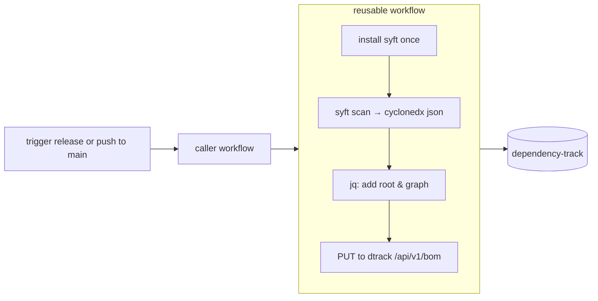

in this post, i'll walk through a reusable github actions workflow that generates software bills of materials (sbom) for container images and publishes them to dependency-track (dtrack).

the goal is to have a clear inventory of what's inside each container image we ship, and to make that inventory available to dependency-track for vulnerability tracking and license compliance.

## why sboms matter

an sbom is a formal, machine-readable inventory of all components and dependencies in a piece of software. for container images, this means knowing every package, library, and runtime included in the image.

having sboms helps with:

- vulnerability management: when a new cve is disclosed, you can quickly check whether any of your images are affected.
- license compliance: track the licenses of all dependencies to avoid legal surprises.
- supply-chain security: verify that only expected components are present in your images.

## about syft

syft is an open-source tool by anchore that generates software bills of materials from container images and filesystems. it inspects an image's layers, catalogs every installed package and library, and emits a machine-readable inventory in formats such as cyclonedx json. that inventory is what dependency-track consumes to track vulnerabilities and licenses over time. see the [syft documentation](https://oss.anchore.com/docs/reference/syft/cli/) for more details.

## the workflow

the workflow lives somewhere at `.github/workflows/syft-dtrack.yml` and is designed as a reusable workflow (`workflow_call`). it is invoked from other workflows (for example, the ones that build and push docker images) with a list of images to scan.



here is a high-level view of what it does:

1. installs syft once, then shares the binary across jobs via artifacts.
2. scans each container image in parallel using a matrix strategy.
3. generates a cyclonedx json sbom for each image.
4. enriches the sbom with a synthetic container root component and a dependency graph.
5. publishes the sbom to dependency-track.

### installing syft

the first job, `syft-install`, downloads and installs the syft binary from the official anchore installer:

```bash
# create a directory for the syft installer and binary.
mkdir -p "$RUNNER_TEMP/syft"
# download the installer to a file instead of piping it directly to a shell.
curl -sSfL -o "$RUNNER_TEMP/syft/install.sh" https://get.anchore.io/syft
# confirm the installer downloaded successfully before running it.
test -s "$RUNNER_TEMP/syft/install.sh"
# install syft into the temporary directory.
sh "$RUNNER_TEMP/syft/install.sh" -b "$RUNNER_TEMP/syft"
```

note that we avoid the `curl | shell` anti-pattern. the installer is downloaded to a file first, verified to be non-empty, and only then executed. the binary is then uploaded as a workflow artifact so the scanning jobs can reuse it without re-downloading.

### scanning images in parallel

the second job, `syft-dtrack`, runs once per image using a matrix. the caller passes a json array of objects, each with `image`, `version`, and `dtrack_project_name`:

```yaml
strategy:
  matrix:
    include: ${{ fromJSON(inputs.images) }}
```

for each matrix entry, the job downloads the syft binary, computes a sha-256 identity from the exact `image:version` reference, and runs syft to generate a cyclonedx json sbom:

```bash
# download the syft binary artifact shared from the install job.
# this step is handled by the actions/download-artifact action in the workflow.

# build the exact image reference that syft will scan.
IMAGE_REFERENCE="$IMAGE:$VERSION"
# hash the reference to give this image's generated files a stable unique name.
IMAGE_SHA256="$(printf '%s' "$IMAGE_REFERENCE" | sha256sum | cut -d ' ' -f 1)"
# use the hash in the sbom filename to avoid collisions between matrix jobs.
SBOM_FILE="sbom-${IMAGE_SHA256}.json"

# scan the selected image and write its inventory as cyclonedx json.
syft "$IMAGE:$VERSION" --select-catalogers -file -o "cyclonedx-json=$SBOM_FILE"
```

arguments:

- `$IMAGE:$VERSION`: the container image reference to scan (for example `ghcr.io/mota-lhd/blog-backend:latest`).
- `--select-catalogers`: expression-based selection that adds, removes, or filters the catalogers syft runs.
- `-file`: selection expression that removes the catalogers tagged `file`, so the sbom contains installed packages only, without per-file entries.
- `-o "cyclonedx-json=$SBOM_FILE"`: sets the output format to cyclonedx json and names the output file `$SBOM_FILE`.

using a content-derived hash avoids collisions and makes the file names deterministic and stable across runs. this produces a packages-only sbom listing all installed packages discovered in the image.

### enriching the dependency graph

syft's output already includes a dependency graph, but it doesn't include a root component representing the container image itself. we use `jq` to add a synthetic container root:

```bash
# pass the image name and version into the jq program as data.
jq \
  --arg name "$IMAGE" \
  --arg version "$VERSION" \
  '# build a stable reference for the scanned container.
  ($name + "@" + $version) as $rootRef |
  # components not referenced by another dependency are direct dependencies of the root.
  ([.components[]?["bom-ref"]] - [.dependencies[]?.dependsOn[]?] | unique) as $topLevelRefs |
  # add the root component to metadata and the component inventory.
  .metadata.component = {
    "type": "container",
    "name": $name,
    "version": $version,
    "bom-ref": $rootRef
  } |
  .components = (.components // []) + [.metadata.component] |
  # link the root to direct dependencies while preserving the existing syft graph.
  .dependencies = [{ "ref": $rootRef, "dependsOn": $topLevelRefs }] + (.dependencies // [])' \
  "$SBOM_FILE" > "$SBOM_GRAPH_FILE"
# replace the original only after jq has successfully written the enriched sbom.
mv "$SBOM_GRAPH_FILE" "$SBOM_FILE"
```

the original file is only replaced after `jq` successfully writes the transformed sbom, so a failed transformation never clobbers a good sbom.

### publishing to dependency-track

finally, the sbom is base64-encoded and sent to dependency-track's bom api:

```bash
# remove a trailing slash so the api path is appended correctly.
DTRACK_URL="${DTRACK_URL%/}"
# base64-encode the sbom and wrap it in dependency-track's upload json payload.
base64 -w 0 "$SBOM_FILE" \
  | jq -Rs \
      --arg pn "$PROJECT_NAME" \
      --arg pv "$PROJECT_VERSION" \
      '{projectName:$pn, projectVersion:$pv, autoCreate:false, bom:.}' \
  > "$payload"

# upload the payload
curl -sS -f -X PUT "$DTRACK_URL/api/v1/bom" \
  -H "X-Api-Key: $DTRACK_API_KEY" \
  -H "Content-Type: application/json" \
  --data-binary "@$payload"
```

`autoCreate:false` means the project must already exist in dependency-track; the workflow will not create it automatically. the api key is passed as a github secret and never appears in logs.

## when it runs

for efficiency, the workflow is triggered at release time or on push to the main branch, rather than on every pull request. this avoids scanning images that may never be shipped while ensuring every released image gets an sbom.

## full workflow

here is the complete reusable workflow

```yaml
name: Syft + dTrack

on:
  workflow_call:
    inputs:
      images:
        description: JSON array of objects containing image, version, and dtrack_project_name
        required: true
        type: string
      dtrack_url:
        description: Base URL of the Dependency-Track server
        required: true
        type: string
    secrets:
      DTRACK_API_KEY:
        description: API key used to publish BOMs to Dependency-Track
        required: true

jobs:
  syft-install:
    runs-on: ubuntu-latest
    steps:
      - name: syft/install
        run: |
          # download syft installer first (avoid curl | shell pattern)
          mkdir -p "$RUNNER_TEMP/syft"
          curl -sSfL -o "$RUNNER_TEMP/syft/install.sh" https://get.anchore.io/syft
          # verify the installer was downloaded and is executable
          test -s "$RUNNER_TEMP/syft/install.sh"
          # execute the downloaded installer
          sh "$RUNNER_TEMP/syft/install.sh" -b "$RUNNER_TEMP/syft"

      - name: syft/upload
        uses: actions/upload-artifact@043fb46d1a93c77aae656e7c1c64a875d1fc6a0a
        with:
          name: syft-binary
          path: ${{ runner.temp }}/syft/syft
          if-no-files-found: error

  syft-dtrack:
    needs: syft-install
    runs-on: ubuntu-latest
    strategy:
      matrix:
        include: ${{ fromJSON(inputs.images) }}
    steps:
      - name: syft/download
        uses: actions/download-artifact@3e5f45b2cfb9172054b4087a40e8e0b5a5461e7c
        with:
          name: syft-binary
          path: ${{ runner.temp }}/syft

      - name: syft/activate
        run: |
          chmod +x "$RUNNER_TEMP/syft/syft"
          echo "$RUNNER_TEMP/syft" >> "$GITHUB_PATH"

      - name: image/identity
        id: image_identity
        env:
          IMAGE: ${{ matrix.image }}
          VERSION: ${{ matrix.version }}
        run: |
          # hash the exact reference used by syft; sha-256 avoids md5/sha-1 collisions.
          IMAGE_REFERENCE="$IMAGE:$VERSION"
          IMAGE_SHA256="$(printf '%s' "$IMAGE_REFERENCE" | sha256sum | cut -d ' ' -f 1)"
          echo "image_sha256=$IMAGE_SHA256" >> "$GITHUB_OUTPUT"

      - name: image/sbom
        env:
          IMAGE: ${{ matrix.image }}
          VERSION: ${{ matrix.version }}
          IMAGE_SHA256: ${{ steps.image_identity.outputs.image_sha256 }}
        run: |
          SBOM_FILE="sbom-${IMAGE_SHA256}.json"
          syft "$IMAGE:$VERSION" --select-catalogers -file -o "cyclonedx-json=$SBOM_FILE"

      - name: sbom/deps-graph
        env:
          IMAGE: ${{ matrix.image }}
          VERSION: ${{ matrix.version }}
          IMAGE_SHA256: ${{ steps.image_identity.outputs.image_sha256 }}
        run: |
          SBOM_FILE="sbom-${IMAGE_SHA256}.json"
          SBOM_GRAPH_FILE="sbom-with-graph-${IMAGE_SHA256}.json"
          # add a synthetic container root to the cyclonedx dependency graph.
          jq \
            --arg name "$IMAGE" \
            --arg version "$VERSION" \
            '# build a stable reference for the scanned container.
            ($name + "@" + $version) as $rootRef |
            # components not referenced by another dependency are direct dependencies of the root.
            ([.components[]?["bom-ref"]] - [.dependencies[]?.dependsOn[]?] | unique) as $topLevelRefs |
            # add the root component to metadata and the component inventory.
            .metadata.component = {
              "type": "container",
              "name": $name,
              "version": $version,
              "bom-ref": $rootRef
            } |
            .components = (.components // []) + [.metadata.component] |
            # link the root to direct dependencies while preserving the existing syft graph.
            .dependencies = [{ "ref": $rootRef, "dependsOn": $topLevelRefs }] + (.dependencies // [])' \
            "$SBOM_FILE" > "$SBOM_GRAPH_FILE"
          # replace the original only after jq successfully writes the transformed sbom.
          mv "$SBOM_GRAPH_FILE" "$SBOM_FILE"

      - name: dtrack/publish
        env:
          DTRACK_URL: ${{ inputs.dtrack_url }}
          DTRACK_API_KEY: ${{ secrets.DTRACK_API_KEY }}
          IMAGE_SHA256: ${{ steps.image_identity.outputs.image_sha256 }}
          PROJECT_NAME: ${{ matrix.dtrack_project_name }}
          PROJECT_VERSION: ${{ matrix.version }}
        run: |
          SBOM_FILE="sbom-${IMAGE_SHA256}.json"
          payload="$RUNNER_TEMP/dtrack-payload-${IMAGE_SHA256}.json"
          # normalize the base url before appending the dependency-track api path.
          DTRACK_URL="${DTRACK_URL%/}"

          base64 -w 0 "$SBOM_FILE" \
            | jq -Rs \
                --arg pn "$PROJECT_NAME" \
                --arg pv "$PROJECT_VERSION" \
                '{projectName:$pn, projectVersion:$pv, autoCreate:false, bom:.}' \
            > "$payload"

          curl -sS -f -X PUT "$DTRACK_URL/api/v1/bom" \
            -H "X-Api-Key: $DTRACK_API_KEY" \
            -H "Content-Type: application/json" \
            --data-binary "@$payload"
```

## how to call it

a caller workflow invokes this reusable workflow with a json array of images to scan:

```yaml
- uses: ./.github/workflows/syft-dtrack.yml
  with:
    images: |
      [
        {"image": "ghcr.io/mota-lhd/blog-backend", "version": "latest", "dtrack_project_name": "blog-backend"},
        {"image": "ghcr.io/mota-lhd/blog-frontend", "version": "latest", "dtrack_project_name": "blog-frontend"}
      ]
    dtrack_url: "https://dtrack.example.com"
  secrets:
    DTRACK_API_KEY: ${{ secrets.DTRACK_API_KEY }}
```

each object in the `images` array creates one matrix job, so all images are scanned in parallel. the `dtrack_url` is the base url of your dependency-track server, and `DTRACK_API_KEY` is passed as a github secret so it never appears in logs.

## key takeaways

✅ reusable workflow: one definition, invoked by multiple pipelines.

✅ parallel scanning: matrix strategy scans many images at once.

✅ enriched dependency graph: a synthetic container root links the image to its direct dependencies.

✅ secret-safe: the dependency-track api key is passed through github secrets, never logged.

this pipeline gives us a reliable, repeatable way to produce sboms for every container image we ship and feed them into dependency-track for ongoing vulnerability and license monitoring.
